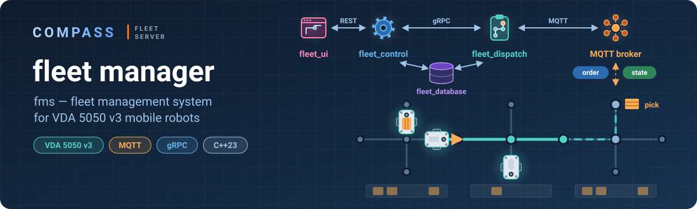
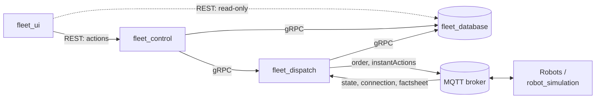

<p align="center">
  
</p>

# Fleet Manager

**fms: a fleet management system for mobile robots that speak [VDA 5050 v3](https://github.com/VDA5050/VDA5050).**

The fms takes missions from people and systems, turns them into VDA 5050 orders, sends them to robots over MQTT and tracks how the robots carry them out. Any robot that implements VDA 5050 v3 can join the fleet. The repository also contains a robot simulator, so the whole system runs on one machine without hardware.

> **Work in progress.** The robot simulator is complete and covered by tests; the fms services are being built step by step.

## Components



| Directory | What it is | Status |
|---|---|---|
| [`fleet_control`](fleet_control) | Brain of the fms: runs the fleet — robots, missions, task allocation, routes and traffic; REST for actions from the UI | in progress |
| [`fleet_dispatch`](fleet_dispatch) | Talks to robots: one session per robot, VDA 5050 orders and instant actions, robot status stream to fleet_control over gRPC | in progress |
| [`fleet_database`](fleet_database) | Storage over PostgreSQL: gRPC for the services, read-only REST for the UI | in progress |
| [`robot_simulation`](robot_simulation) | Mobile robot simulator speaking VDA 5050 v3 over MQTT | ✅ [details](robot_simulation/README.md) |
| [`proto`](proto) | gRPC contracts between the services | v1 |
| [`vda5050`](vda5050) | Header-only C++ structs for VDA 5050 v3 messages (nlohmann/json) | ✅ |
| [`shared`](shared) | Common libraries: HTTP and gRPC servers, MQTT client, robot JSON for the UI, configuration from the environment | |
| [`robot_simulation/tests`](robot_simulation/tests) | End-to-end Python tests of the robot protocol | ✅ |

## Tech stack

C++23 · Boost.Asio, Boost.Beast and Boost.MQTT5 · gRPC with [asio-grpc](https://github.com/Tradias/asio-grpc) · PostgreSQL with libpqxx · BehaviorTree.CPP · nlohmann/json · spdlog · CMake and vcpkg.

## Building

Dependencies are listed in [`vcpkg.json`](vcpkg.json).

```bash
cmake -S . -B build -DCMAKE_BUILD_TYPE=Debug -DCMAKE_TOOLCHAIN_FILE=$VCPKG_ROOT/scripts/buildsystems/vcpkg.cmake
```

```bash
cmake --build build -j
```

The first build takes a while: vcpkg builds the dependencies, gRPC included.

To try the robots right away, see [Running the simulator](robot_simulation/README.md#running).
