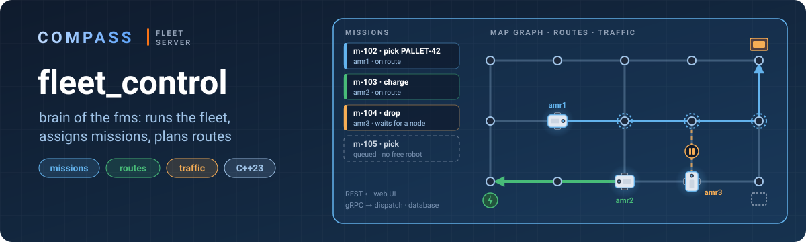
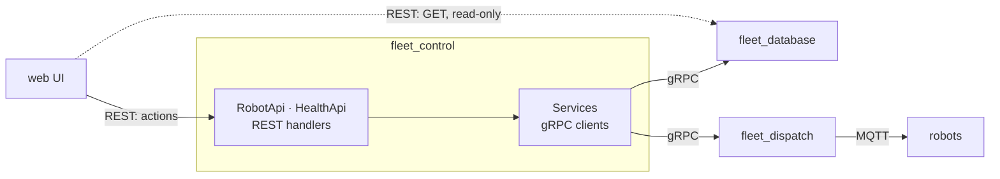

<p align="center">
  
</p>

# fleet_control

**The brain of the fms: it runs the fleet.**

fleet_control decides what every robot does. It keeps the fleet — which robots exist, which of them can work — takes missions from people and systems, picks a robot for each mission, plans its route on the map graph and keeps robots out of each other's way by reserving the nodes ahead of them. fleet_dispatch then turns these decisions into VDA 5050 orders for the robots.

It is also the entry point for actions: the web UI registers, changes, pauses and deletes robots through fleet_control, and later creates missions. fleet_control stores what must be kept in fleet_database and gives commands to fleet_dispatch; it never talks to robots or to PostgreSQL itself — only to the other services, over gRPC.

| Responsibility | Status |
|---|---|
| Robots: register, change, delete, pause; whether a robot can work (`availability`) | in progress |
| Missions: queue, priorities, status for the UI | planned |
| Task allocation: which robot takes which mission | planned |
| Routes on the map graph | planned |
| Traffic: node reservations, no deadlocks | planned |

> **Work in progress.** Health and robot registration work; deleting and pausing robots come next, then missions, task allocation, routes and traffic.

## How it works



**Who answers what.** By the UI contract (`docs/API_CONTRACT.md` in the UI repository) a gateway in front of the fms routes `GET /api/fms/*` to fleet_database (read-only) and every action — `POST`, `PATCH`, `DELETE` — to fleet_control. So fleet_control has no `GET` for robots: the UI reads them from the database, where fleet_dispatch keeps their status up to date.

| Part | Responsibility |
|---|---|
| `HttpServer`, `ApiRouter` | HTTP server and route table (shared with fleet_database, from `shared/`) |
| `RobotApi` | robots: check the request, `CreateRobot` / `UpdateRobot` in fleet_database, `AddRobot` in fleet_dispatch; answers in the contract format |
| `HealthApi` | `GET /api/health`: control itself and whether fleet_database and fleet_dispatch are serving |
| `Services` | gRPC clients: one channel per service, stubs, `call<…>()` — one unary call with a 3 s deadline |

Everything runs on **one thread**: `agrpc::run` drives the gRPC client context and the Asio context of the HTTP server, so there are no mutexes. fleet_control has no gRPC server of its own — nobody calls it over gRPC.

**fleet_database is the source of truth.** A robot is registered as soon as it is in the database. If fleet_dispatch is down at that moment, the registration still succeeds (201) and the robot gets to dispatch later, when fleet_control reconciles the database with dispatch (next step).

## REST API

Format and errors — the UI contract: `camelCase`, enums without prefixes, time in ISO 8601 UTC with milliseconds; errors `{"code": "INVALID_INPUT", "message": "...", "details": {"field": "why"}}`.

| Path | What it does | Status |
|---|---|---|
| `GET /api/health` | `{"status": "OK" \| "DEGRADED", "services": {"control", "database", "dispatch"}}` | ✅ |
| `POST /api/fms/robots` | register: `{id, manufacturer, serialNumber, name?, labels?}` → 201 `Robot` | ✅ |
| `PATCH /api/fms/robots/{id}` | change `name` and `labels`; `id`, `manufacturer`, `serialNumber` cannot change | ✅ |
| `DELETE /api/fms/robots/{id}` | soft delete → 202; 409 `ROBOT_BUSY` while it has a mission, `?force=true` cancels it | next |
| `POST /api/fms/robots/{id}/pause`, `/resume` | VDA `startPause` / `stopPause` → 202 | next |
| missions, maps, alarms | | planned |

| Error | When |
|---|---|
| 400 `INVALID_INPUT` | body is not a JSON object or fields are wrong; all wrong fields at once in `details` |
| 404 `NOT_FOUND` | no such robot |
| 409 `ALREADY_EXISTS` | `id` is taken, or the pair `manufacturer + serialNumber` is already registered |
| 503 `UNAVAILABLE` | fleet_database or fleet_dispatch does not answer — retry later |

There is no authentication in the service: the gateway checks the JWT. Do not expose the HTTP port directly.

## Configuration

Environment variables, with defaults for development:

| Variable | Default | What |
|---|---|---|
| `HTTP_ADDRESS` | `0.0.0.0:8003` | REST listen address |
| `DATABASE_ADDRESS` | `127.0.0.1:5002` | gRPC of fleet_database |
| `DISPATCH_ADDRESS` | `127.0.0.1:5001` | gRPC of fleet_dispatch |

fleet_control starts even when the other services are not running yet; gRPC connects to them on the first call and reconnects after they restart.

## Building and running

From the repository root (see the [main README](../README.md#building)):

```bash
cmake --build build --target fleet_control -j
```

```bash
./build/fleet_control/fleet_control
```

For real work start [fleet_database](../fleet_database/README.md) and [fleet_dispatch](../fleet_dispatch/README.md) too. Stop with Ctrl+C.

### Check it

```bash
curl -s -w '\n' http://localhost:8003/api/health
```

```json
{"services":{"control":"OK","database":"OK","dispatch":"OK"},"status":"OK"}
```

Register a robot of the [simulator](../robot_simulation/README.md) and watch its status appear in the database:

```bash
curl -s -w '\n' -X POST http://localhost:8003/api/fms/robots -H "Content-Type: application/json" -d '{"id":"amr-01","manufacturer":"ktc","serialNumber":"amr1","name":"AMR 01"}'
```

```bash
curl -s -w '\n' http://localhost:8002/api/fms/robots/amr-01
```

Automated tests: [`tests/`](tests) (pytest, instead of the UI).

## Layout

```
fleet_control/
├── fc_main.cpp          configuration, start and shutdown order
├── include/             headers
├── src/
│   ├── Services.cpp     gRPC clients of fleet_database and fleet_dispatch
│   ├── HealthApi.cpp    GET /api/health
│   └── RobotApi.cpp     robots: POST, PATCH
├── docs/                banner
└── tests/               pytest: REST of control, checked in the database and dispatch
```
