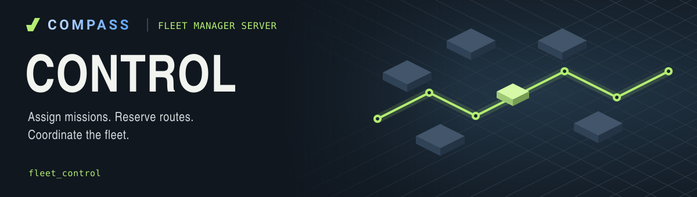

<p align="center">
  
</p>

# Fleet control · `fleet_control`

Assigns missions to available robots and reserves the nodes and lanes they need. A robot waits when another robot holds the next section of its route. Operators use this service to create or cancel missions and see how far each robot is allowed to travel.

## Build

Run the commands from the repository root. For the first build, set `VCPKG_ROOT` to your vcpkg installation and configure the build directory:

```bash
cmake -S . -B cmake-build-debug -DCMAKE_BUILD_TYPE=Debug \
  -DCMAKE_TOOLCHAIN_FILE="$VCPKG_ROOT/scripts/buildsystems/vcpkg.cmake"
```

Once configured, build the service:

```bash
cmake --build cmake-build-debug --target fleet_control -j 4
```

## Run

Start [fleet_database](../fleet_database/README.md) and [fleet_dispatch](../fleet_dispatch/README.md), then launch fleet_control in a separate terminal:

```bash
DATABASE_ADDRESS=127.0.0.1:5002 DISPATCH_ADDRESS=127.0.0.1:5001 \
  ./cmake-build-debug/fleet_control/fleet_control
```

Check the connections from another terminal:

```bash
curl -sS http://127.0.0.1:8003/api/health
```

A healthy service returns `"status":"OK"`. If the status is `DEGRADED`, the `services` field shows which connection needs attention.

To run all four services together, see the [test stand guide](../deploy/README.md).
