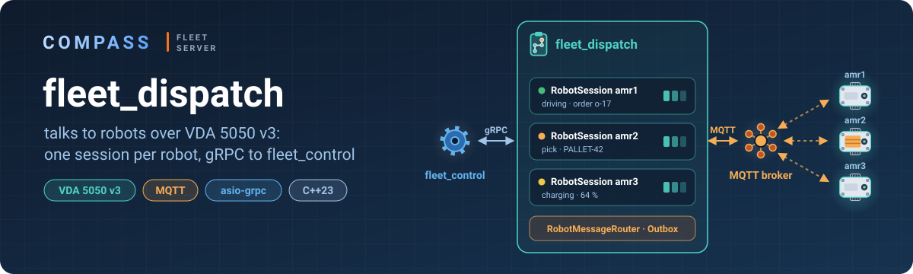
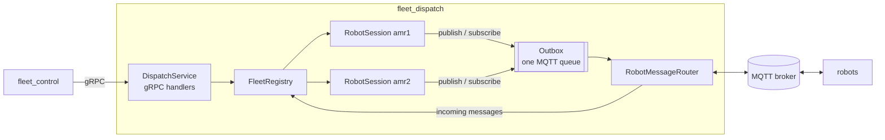

<p align="center">
  
</p>

# fleet_dispatch

**The part of the fms that talks to robots.**

fleet_control decides *what* the fleet should do; fleet_dispatch makes the robots do it. It keeps one session per robot, turns commands from fleet_control into VDA 5050 v3 `order` and `instantActions` messages, reads what the robots publish (`state`, `connection`, `factsheet`) and streams robot and mission status back to fleet_control over gRPC.

> **Work in progress.** The gRPC server, the robot registry and the MQTT transport work; status streaming, orders and missions are next.

## How it works



| Part | Responsibility |
|---|---|
| `GrpcServer` | gRPC server with health checking and reflection; graceful shutdown |
| `DispatchService` | gRPC handlers from [`fleet_dispatch.proto`](../proto/fleet_dispatch.proto); pure transport, no business logic |
| `FleetRegistry` | creates and removes robot sessions; the only owner of `RobotSession` |
| `RobotSession` | everything about one robot: its topics, an inbox of incoming messages processed one at a time, the robot's `RobotStatus` |
| `Outbox` | one queue of MQTT requests (publish / subscribe / unsubscribe) shared by all sessions |
| `RobotMessageRouter` | MQTT transport: executes `Outbox` requests in order and routes incoming messages to the right session by topic |
| `RobotStatusBuilder` | converts a VDA 5050 `state` into `fms::v1::RobotStatus` |

Everything runs on **one thread**: `agrpc::run` drives both the gRPC and the Asio contexts, so there are no mutexes. A session never touches MQTT or gRPC directly; it only puts requests into the `Outbox`.

Messages from robots are untrusted: a message that is not valid JSON or VDA 5050 is dropped and counted in `RobotStatus.protocol`, and the session keeps running.

## gRPC API

Defined in [`proto/fleet_dispatch.proto`](../proto/fleet_dispatch.proto) (package `fms.dispatch.v1`), port **5001**.

| RPC | What it does | Status |
|---|---|---|
| `AddRobot` | start a session: subscribe to the robot's `state`, `connection`, `factsheet` | ✅ |
| `RemoveRobot` | stop the session and unsubscribe | ✅ |
| `StreamRobotStatus` | snapshot of all robots, then every change | next |
| `PauseRobot` / `ResumeRobot` / `InitializePosition` | instant actions | planned |
| `AddMission` / `CancelMission` / `ExtendMission` | missions → VDA 5050 orders | planned |
| `StreamMissionStatus` | snapshot of missions, then every change | planned |

Errors are gRPC status codes (`INVALID_ARGUMENT`, `NOT_FOUND`, `ALREADY_EXISTS`, …).

## Building and running

From the repository root (see the [main README](../README.md#building)):

```bash
cmake --build build --target fleet_dispatch -j
```

Start an MQTT broker, the [robot simulator](../robot_simulation/README.md#running) and then the dispatcher:

```bash
./build/fleet_dispatch/fleet_dispatch
```

It connects to the broker at `127.0.0.1:1883` and listens for gRPC on `0.0.0.0:5001`. Stop it with Ctrl+C.

### Try it with grpcurl

```bash
grpcurl -plaintext localhost:5001 list
```

```bash
grpcurl -plaintext -d '{"robot_id":"amr-01","manufacturer":"ktc","serial_number":"amr1"}' localhost:5001 fms.dispatch.v1.FleetDispatch/AddRobot
```

The log now shows the robot's status on every `state`:

```
[amr-01] CONNECTION_STATE_ONLINE OPERATING_MODE_AUTOMATIC node= battery=80% driving=false errors=0
```

```bash
grpcurl -plaintext -d '{"robot_id":"amr-01"}' localhost:5001 fms.dispatch.v1.FleetDispatch/RemoveRobot
```

## Layout

```
fleet_dispatch/
├── fd_main.cpp              wiring, start and shutdown order
├── include/                 headers; RobotStatusBuilder: VDA state → RobotStatus
└── src/
    ├── GrpcServer.cpp       gRPC server, health, reflection
    ├── DispatchService.cpp  gRPC handlers
    ├── FleetRegistry.cpp    robot sessions
    ├── RobotSession.cpp     one robot: inbox, message handling, status
    └── RobotMessageRouter.cpp  MQTT in and out
```
