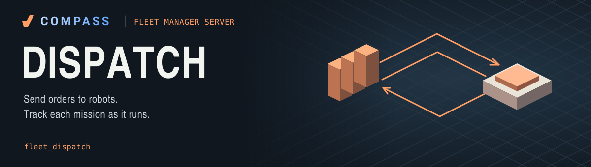

<p align="center">
  
</p>

# Robot communication · `fleet_dispatch`

Receives missions from fleet_control and sends orders to robots. It reports when a robot starts moving, reaches a node, completes an action, or encounters an error. It also delivers route extensions and cancellation requests.

## Build

Run the commands from the repository root. For the first build, set `VCPKG_ROOT` to your vcpkg installation and configure the build directory:

```bash
cmake -S . -B cmake-build-debug -DCMAKE_BUILD_TYPE=Debug \
  -DCMAKE_TOOLCHAIN_FILE="$VCPKG_ROOT/scripts/buildsystems/vcpkg.cmake"
```

Once configured, build the service:

```bash
cmake --build cmake-build-debug --target fleet_dispatch -j 4
```

## Run

Start [fleet_database](../fleet_database/README.md) and the MQTT broker. On the WSL test machine, start Mosquitto with:

```bash
sudo systemctl start mosquitto
```

The test broker listens on port `1884`. If it requires authentication, set `MQTT_USER` and `MQTT_PASSWORD` in the environment before starting dispatch:

```bash
DATABASE_ADDRESS=127.0.0.1:5002 MQTT_HOST=127.0.0.1 MQTT_PORT=1884 \
  ./cmake-build-debug/fleet_dispatch/fleet_dispatch
```

Look for `fleet_dispatch started` in the log. Fleet control connects on `127.0.0.1:5001`. To run a mission, connect a robot or the [simulator](../robot_simulation/README.md) to the same broker.

To run all four services together, see the [test stand guide](../deploy/README.md).
