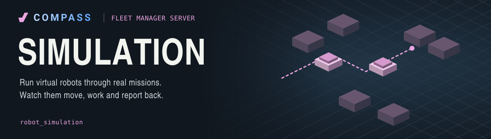

<p align="center">
  
</p>

# Mobile robot simulator · `robot_simulation`

Runs virtual robots that accept orders, travel between nodes, perform actions, and report their position and battery level. Use it to exercise mission assignment, traffic conflicts, and cancellations before testing on the warehouse or factory floor.

## Build

Run the commands from the repository root. For the first build, set `VCPKG_ROOT` to your vcpkg installation and configure the build directory:

```bash
cmake -S . -B cmake-build-debug -DCMAKE_BUILD_TYPE=Debug \
  -DCMAKE_TOOLCHAIN_FILE="$VCPKG_ROOT/scripts/buildsystems/vcpkg.cmake"
```

Once configured, build the service:

```bash
cmake --build cmake-build-debug --target robot_simulation -j 4
```

## Run

Check the following settings in [config.yaml](config/config.yaml):

- `mqtt` sets the broker address, port, and credentials. Use the same broker as fleet_dispatch.
- `robots` lists the simulated robots. `initial_state` sets their starting map, position, and battery level. Use the mission’s map when testing in COMPASS.
- `behavior_tree.xml_path` must point to [robot_tree.xml](trees/robot_tree.xml).

On the WSL test machine, the simulator reads `/home/ubuntu/fleet-manager/robot_simulation/config/config.yaml`. If your checkout is elsewhere, update the path in [rs_main.cpp](src/rs_main.cpp) before building and adjust the XML path in the configuration.

Start the broker and simulator:

```bash
sudo systemctl start mosquitto
./cmake-build-debug/robot_simulation/robot_simulation
```

The log shows each robot’s serial number and `Waiting for order`. To send a mission through COMPASS, start [fleet_dispatch](../fleet_dispatch/README.md) and [fleet_control](../fleet_control/README.md), register the robot using its logged serial number, and set its position on the map.

To run all four services together, see the [test stand guide](../deploy/README.md).
