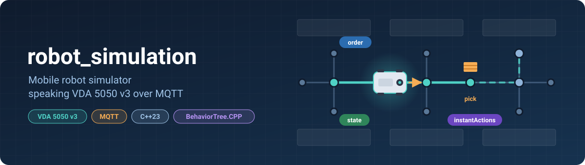
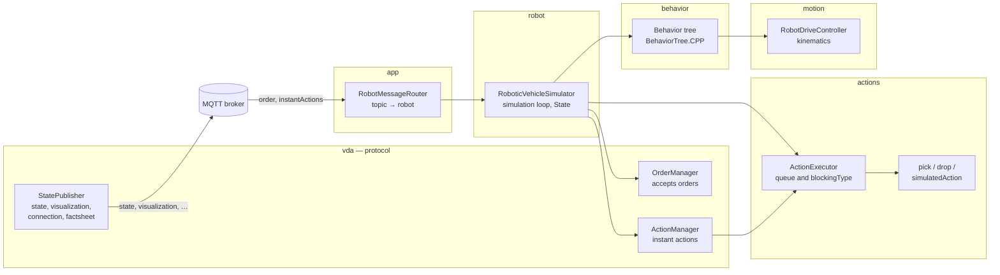
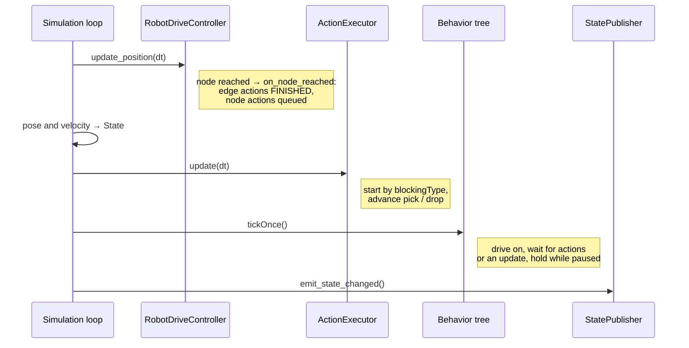
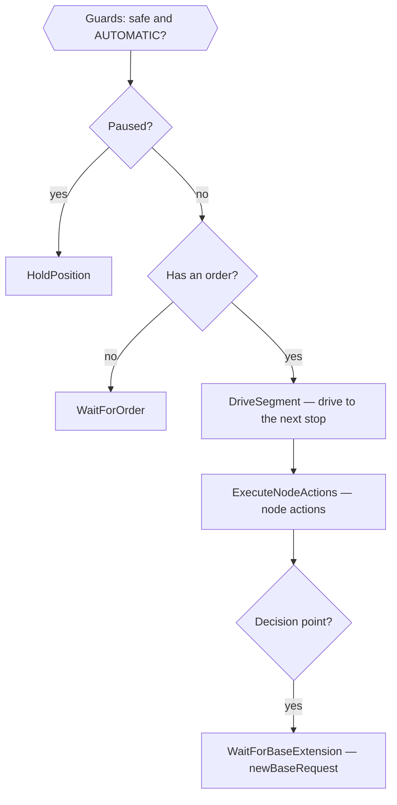

<p align="center">
  
</p>

# robot_simulation

**A simulator of mobile robots that talk [VDA 5050 v3](https://github.com/VDA5050/VDA5050) over MQTT.**

To the fms they look like real robots. They connect to the broker, accept orders and instant actions, drive along the graph, pick and drop loads, and publish `state`, `visualization`, `connection` and `factsheet`. There is no hardware: everything runs in one process on your machine.

## Why it exists

- **Develop the fms without robots.** Run and debug fleet_dispatch and fleet_control on a laptop; three robots start with a single command.
- **Reproduce the hard cases.** Pausing during a pick, cancelling an order while driving, an order update at the decision point, a rejected order. On a real shop floor these are slow and awkward to set up; here each one is a few-second scenario.
- **Keep the protocol honest.** The simulator follows the VDA 5050 v3 specification, and 70 automated end-to-end tests check it (`tests/` at the repository root).

## Features

| | |
|---|---|
| 🧭 **Orders** | base and horizon, updates while driving and at the decision point, `newBaseRequest`, every rejection from 6.1.4 (`OTHER_ORDER_ACTIVE`, `OUTDATED_ORDER_UPDATE`, `START_NODE_OUT_OF_RANGE`, …) |
| 🚗 **Motion** | node to node with acceleration, braking and smooth cornering; stops wherever an action must run |
| 📦 **Actions** | `pick` / `drop` (the load shows up in `loads`) and `simulatedAction`, a generic action with a configurable duration; every `blockingType` (NONE / SOFT / SINGLE / HARD), on nodes and on edges |
| ⏯️ **Instant actions** | `cancelOrder`, `startPause` / `stopPause`, `stateRequest`, `factsheetRequest`, `initializePosition` |
| 📡 **Messages** | `state` on every change and at least every 30 s, `visualization` every 200 ms, retained `connection` (QoS 1) and `factsheet` |
| 🤖 **Many robots** | any number in one process, each with its own topics |

## How it works

### What a robot is made of



Each robot is a `RoboticVehicleSimulator` object. It owns a `vda5050::State` (exactly what goes to the `state` topic) and delegates the work:

| Part | Responsibility |
|---|---|
| `OrderManager` | validates an order (structure, map, actions against the factsheet), accepts a new order or an update, maintains `nodeStates` / `edgeStates` |
| `ActionManager` | instant actions: cancel, pause, requests, position initialization |
| `ActionExecutor` | the action queue: what starts when according to `blockingType`, pause, cancel, finishing actions when the robot leaves an edge |
| Behavior tree | decides what the robot does right now: wait for an order, drive, run node actions, wait for an update, hold position while paused |
| `RobotDriveController` | moves the robot along waypoints: speed, acceleration, turns, "node reached" |
| `StatePublisher` | publishes state on every change (at most once per 100 ms) and on a timer |

### One simulation tick (every 100 ms)



MQTT messages arrive on another thread and are handed over to the simulation thread with `asio::post`. All robot logic is therefore single-threaded and needs no mutexes.

### Behavior tree

The tree lives in [`trees/robot_tree.xml`](trees/robot_tree.xml) and is loaded at startup. To change the behavior, edit the XML and restart the simulator; no rebuild needed.



The pause is checked on **every** tick (`ReactiveFallback`), so `startPause` stops the robot immediately wherever it is.

### Actions and blockingType

| blockingType | Where it runs | The robot meanwhile |
|---|---|---|
| `NONE` | on a node, or while driving along an edge | keeps driving; edge actions finish when the robot leaves the edge |
| `SOFT` | standing | stands; other actions may run in parallel |
| `SINGLE` | while driving | keeps driving; nothing else runs in parallel |
| `HARD` | standing | stands; nothing else runs |

SOFT and HARD actions on an **edge** run while the robot stands at the node before that edge; then it drives on.

`simulatedAction` lets you test the fms against any kind of action without a real mechanism:

```json
{ "actionId": "a1", "actionType": "simulatedAction", "blockingType": "NONE",
  "actionParameters": [ { "key": "duration", "value": 4.0 } ] }
```

It lasts `duration` seconds (3 by default), is allowed on nodes, on edges and as an instant action, and can be paused and cancelled.

## Building

Requirements:

- a C++23 compiler: **GCC 14+** (`<print>` is used);
- CMake 3.15+;
- [vcpkg](https://vcpkg.io): dependencies are listed in `vcpkg.json` at the repository root (Boost.Asio / MQTT5, BehaviorTree.CPP, nlohmann-json, spdlog, yaml-cpp, gRPC).

The simulator is part of the whole repository, but you can build just its target:

```bash
cmake -S . -B build -DCMAKE_BUILD_TYPE=Debug -DCMAKE_TOOLCHAIN_FILE=$VCPKG_ROOT/scripts/buildsystems/vcpkg.cmake
```

```bash
cmake --build build --target robot_simulation -j
```

The first build takes a while because vcpkg builds the dependencies, including gRPC for the other services. Subsequent builds are fast.

In **CLion**, go to *Settings → Build, Execution, Deployment → CMake*, add `-DCMAKE_TOOLCHAIN_FILE=…/vcpkg.cmake` to *CMake options*, and pick the `robot_simulation` target.

## Running

**1. MQTT broker.** For local work, Mosquitto with no configuration is enough: in that mode it accepts connections from the same machine without a password.

```bash
mosquitto -v
```

**2. The simulator**

```bash
./build/robot_simulation/robot_simulation
```

It connects to the broker at `localhost:1883` and starts three robots:

| Robot | Topics |
|---|---|
| `amr1` | `amr/v3/ktc/amr1/…` |
| `amr2` | `amr/v3/ktc/amr2/…` |
| `amr3` | `amr/v3/ktc/amr3/…` |

Each one starts at (0, 0), heading 0, on map `map_1`, in AUTOMATIC mode. Stop with Ctrl+C: the robot loops and the MQTT client shut down cleanly.

**3. Watch what a robot publishes**

```bash
mosquitto_sub -h localhost -t 'amr/v3/ktc/amr1/#' -v
```

### Try it by hand: fetch a load

A three-node order in a straight line: pick a load at `n1` (3 m), drop it at `n2` (6 m).

```bash
mosquitto_pub -h localhost -t amr/v3/ktc/amr1/order -m '{
  "headerId": 1, "timestamp": "2026-01-01T00:00:00.000Z", "version": "3.0.0",
  "manufacturer": "ktc", "serialNumber": "amr1",
  "orderId": "demo-1", "orderUpdateId": 0,
  "nodes": [
    {"nodeId": "n0", "sequenceId": 0, "released": true, "actions": [],
     "nodePosition": {"x": 0, "y": 0, "mapId": "map_1", "allowedDeviationXY": {"a": 0.5, "b": 0.5, "theta": 0}}},
    {"nodeId": "n1", "sequenceId": 2, "released": true,
     "nodePosition": {"x": 3, "y": 0, "mapId": "map_1"},
     "actions": [{"actionId": "pick-1", "actionType": "pick", "blockingType": "HARD",
                  "actionParameters": [{"key": "loadId", "value": "PALLET-42"}]}]},
    {"nodeId": "n2", "sequenceId": 4, "released": true,
     "nodePosition": {"x": 6, "y": 0, "mapId": "map_1"},
     "actions": [{"actionId": "drop-1", "actionType": "drop", "blockingType": "HARD"}]}
  ],
  "edges": [
    {"edgeId": "e1", "sequenceId": 1, "released": true, "actions": []},
    {"edgeId": "e2", "sequenceId": 3, "released": true, "actions": []}
  ]
}'
```

In `state` you will see the robot:
1. drive to `n1`;
2. stop there while `pick-1` goes WAITING → RUNNING → FINISHED and `PALLET-42` appears in `loads`;
3. drive to `n2` and drop the load.

Now pause in the middle of the pick:

```bash
mosquitto_pub -h localhost -t amr/v3/ktc/amr1/instantActions -m '{
  "headerId": 1, "timestamp": "2026-01-01T00:00:00.000Z", "version": "3.0.0",
  "manufacturer": "ktc", "serialNumber": "amr1",
  "actions": [{"actionId": "p1", "actionType": "startPause", "blockingType": "NONE"}]
}'
```

`pick-1` becomes PAUSED and its timer stops. To resume, send the same message with `stopPause` and a new `actionId`.

The simulator does not check the values of `headerId` and `timestamp`, so any values work for manual experiments.

## Tests

The Python end-to-end tests live in [`tests/`](../tests) at the repository root. They act as a small fms: they send orders to a robot and check its responses against the specification. On top of that, general rules are checked for **every** message the robot sends: `headerId` grows by 1, `sequenceId` ordering, mandatory fields, and so on.

```bash
cd tests && python3 -m venv .venv && .venv/bin/pip install -r requirements.txt
```

```bash
VDA_BROKER_HOST=localhost VDA_MANUFACTURER=ktc VDA_SERIAL=amr1 .venv/bin/python -m pytest -v
```

Current status: **70 passed, 1 skipped**. The skipped test checks that state arrives at least every 30 s; it takes half a minute and is enabled with `VDA_RUN_SLOW=1`. See [`tests/README.md`](../tests/README.md) for details and settings.

When a test fails, the full MQTT exchange during that test is saved to `tests/logs/<test name>.log`.

## Layout

```
robot_simulation/
├── trees/robot_tree.xml          behavior tree
├── include/robot_sim/            headers
│   ├── app/                      RobotMessageRouter — MQTT topics → robots
│   ├── robot/                    RoboticVehicleSimulator, robot_config
│   ├── vda/                      OrderManager, ActionManager, StatePublisher, factsheet
│   ├── actions/                  ActionExecutor, pick/drop, simulatedAction
│   ├── behavior/                 behavior tree nodes
│   └── motion/                   RobotDriveController
└── src/                          implementation, same modules + main.cpp
```

Everything except `main.cpp` is built as the static library `robot_sim_core`.

### Adding your own action

1. Subclass `RunningAction` and implement `update(dt)`, returning RUNNING, FINISHED or FAILED; add `pause()`, `resume()` and `cancel()` if needed. See [`SimulatedAction.cpp`](src/actions/SimulatedAction.cpp) for an example.
2. Register it in the robot constructor: `action_executor_.register_handler("myAction", factory)`.
3. Describe it in `factsheet_builder.cpp`: where it is allowed (node, edge, instant) and which `blockingType`s it supports. `OrderManager` uses the factsheet to decide whether to accept an order containing it.

## Configuration

Robot parameters are defined in [`robot_config.hpp`](include/robot_sim/robot/robot_config.hpp): speed and acceleration, pick/drop durations, publishing intervals, dimensions for the factsheet. The number of robots, the manufacturer and the broker address are set in [`main.cpp`](src/main.cpp). Loading from a YAML file is not implemented yet.

## Limitations

- Robots drive between nodes in straight lines; edge trajectories (`trajectory`) are not used yet.
- No obstacles and no other robots in the way: collisions are not simulated.
- The battery does not drain, and charging is not simulated.
- Zones (`zoneSet`) and the `responses` topic are not supported yet.
- On a connection loss the broker does not publish `connection` = `CONNECTIONBROKEN`: the MQTT client's last will is not configured for the robot topics yet.
